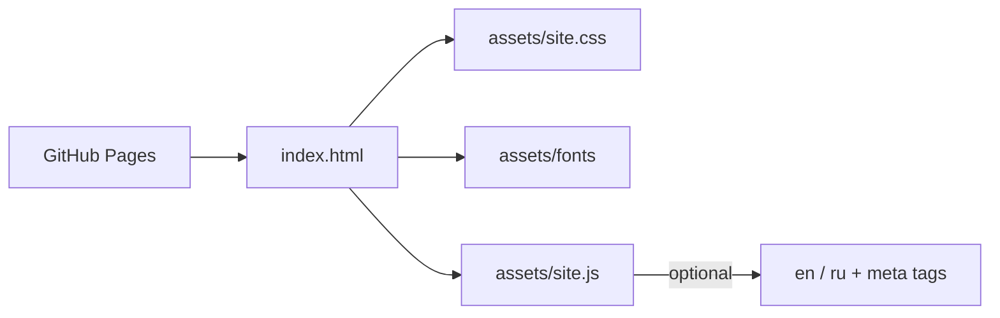

# phylox-site

Public landing page for [Phylox](https://phylox.org): an independent Layer-1 written from scratch in Go, with BFT consensus, 4-second blocks, single-block finality, a 0.0001 YLX base fee, and half of every base fee burned.

## What it is

A single static page, in English and Russian, that explains the network and its parameters. Status on the site is pre-launch: the chain is running on a test bench, and there is no public network yet. The page does not promise launch dates, yield, or guarantees.

Live site: https://phylox.org/

## How it works

There is no build step and no runtime dependencies. GitHub Pages serves the repository root. Language is chosen from `?lang=`, then `localStorage` (`phylox-lang`), then English. The page works without JavaScript; `assets/site.js` only switches language and keeps `<title>` / meta tags in sync.



| File | Role |
|---|---|
| `index.html` | The page; `lang="en"` / `lang="ru"` variants in one document |
| `404.html` | Bilingual not-found page |
| `assets/site.css` | Light and dark themes (`prefers-color-scheme`) |
| `assets/site.js` | Language switch and metadata |
| `assets/fonts/` | IBM Plex (WOFF2, `OFL.txt`) |
| `CNAME` | `phylox.org` |
| `.nojekyll` | Disables Jekyll on Pages |
| `robots.txt`, `sitemap.xml` | Crawling |

Fonts and assets are local. There are no third-party scripts, trackers, or CDNs.

## Stack

HTML, CSS, and a small amount of JavaScript. IBM Plex, self-hosted.

## Quick start

```bash
python -m http.server 8000
```

Open http://localhost:8000/ and http://localhost:8000/?lang=ru. Check both languages, dark theme, and a ~360 px viewport. Every `lang="en"` string should have a `lang="ru"` counterpart, and the meta tags in `index.html` should match `META` in `assets/site.js`.

## Status

This repository is already public and is the source of phylox.org. There are no automated tests; checks are manual, as above. Update `sitemap.xml` `lastmod` when the content changes in a meaningful way.
